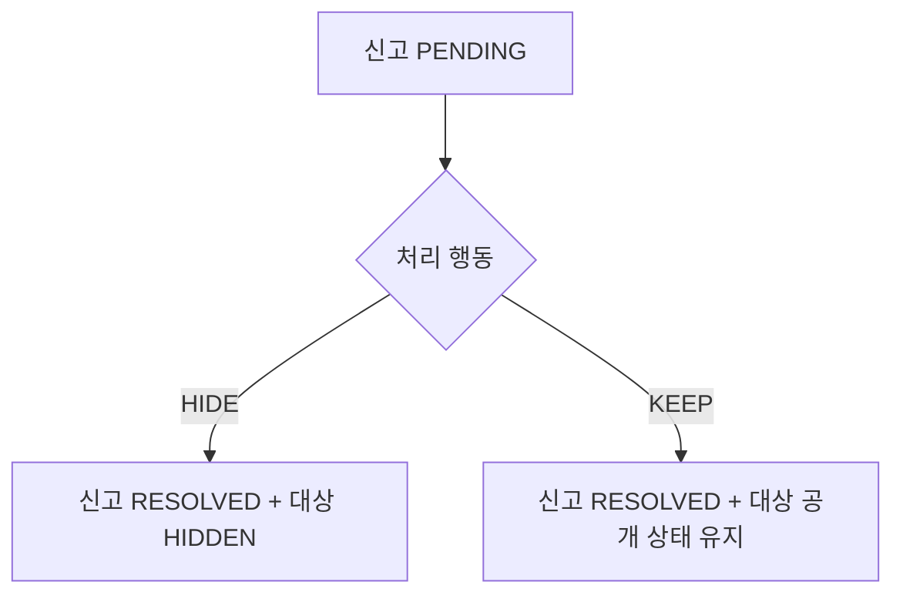

# 4주차 신고·댓글 조회 API

게시글·댓글 신고, 신고 목록·검색, 신고 처리와 댓글 목록·검색을 제공한다. 로그인과 ADMIN 역할은 추가하지 않는다. 요청의 사용자 ID가 존재하는지 확인하는 과제용 방식이며, 존재하는 사용자라면 누구나 신고를 처리하고 조회할 수 있다.

## API

| 요청 | 입력 | 결과 |
| --- | --- | --- |
| POST /posts/{postId}/reports | reporterId, reason | 게시글 신고 생성, 201 |
| POST /comments/{commentId}/reports | reporterId, reason | 댓글 신고 생성, 201 |
| GET /posts/{postId}/comments | page, size, keyword | 해당 게시글의 댓글 목록·본문 검색 |
| GET /reports | page, size, status, targetType, targetId, keyword | 신고 목록·스냅샷 검색 |
| PATCH /reports/{reportId}/resolve | processorId, action, resolutionReason | 신고 처리, 200 |

reason과 resolutionReason은 공백 불가·최대 255자다. 사용자·대상 ID는 양수여야 한다. 모든 응답은 success, 문자열 code, message, data를 사용한다. 성공 코드는 S200/S201이며 실패 시 data는 null이다.

게시글·댓글·신고 목록의 data는 items, page, size, totalElements, totalPages로 통일한다. page는 1부터, size는 기본 10·최대 100이다. 생성 시각과 ID 내림차순으로 정렬한다. 기존 게시글 목록의 data 배열은 이 페이징 객체로 변경되었다.

댓글은 parentId로 대댓글을 연결한 평평한 목록이다. 부모가 다른 페이지에 있어도 ID를 유지한다. 숨김·삭제 댓글은 일반 목록에 안내 문구와 상태만 표시하고 본문 검색에서는 제외한다. 삭제 표시가 우선한다. keyword가 없거나 공백이면 전체 목록이다. 검색은 대소문자를 구분하지 않는 부분 일치이며 %, _, !도 입력 문자 그대로 찾는다.

신고의 status, targetType, targetId 필터는 AND 조건이다. targetId만 지정하면 대상 종류와 무관하게 해당 ID의 신고를 조회한다. keyword는 신고 사유·제목 스냅샷·본문 스냅샷 중 하나라도 포함하면 일치한다. 현재 원문은 검색하지 않는다. 처리 후에는 신고 목록에서 action, resolutionReason, processorId, resolvedAt도 확인할 수 있다.

## 상태와 처리 행동



HIDE/KEEP는 상태가 아닌 처리 행동이다. 신고는 PENDING에서 RESOLVED로 한 번만 전이한다. KEEP는 ACTIVE를 강제하지 않으며 다른 신고로 숨겨진 대상을 복원하지 않는다. 같은 대상의 다른 신고도 자동 처리하지 않는다. 댓글 신고의 HIDE는 그 댓글만 숨기고 부모 게시글을 숨기지 않는다.

신고 접수는 대상 공개 상태를 바꾸지 않는다. 신고 당시 스냅샷은 대상이 수정·삭제되어도 보존한다. HIDE는 수정된 현재 대상을 숨긴다. 대상이 삭제되었으면 KEEP로 종결할 수 있지만 HIDE는 409다. 삭제 대상 처리 응답은 targetAvailable=false, targetHidden=null이다.

숨김 게시글은 목록·제목 검색에서 제외하고 상세·댓글 조회는 404로 응답한다. 숨김 후 작성자가 수정해도 HIDDEN을 유지한다. 기존 작성자 삭제 권한은 유지한다. 과거 검색 이력·검색어 사전·집계 검색량은 유지하므로 숨겨진 게시글과 같은 문자열이 검색어 추천에 남을 수 있다.

## 중복과 동시성

동일 사용자는 같은 대상 종류·ID를 한 번만 신고할 수 있다. 처리 후에도 재신고할 수 없다. 서비스 검사에 더해 DB의 uk_report_reporter_target 유니크 제약으로 보장한다. 해당 제약 위반만 중복 신고 409로 변환하며, 다른 DB 오류를 중복으로 처리하지 않는다.

신고 처리는 신고 행 → 게시글 행 → 댓글 행 순서로 잠근다. 댓글 대상에서만 댓글 행을 잠근다. 게시글 수정·삭제와 신고 접수도 같은 게시글 우선 잠금 순서를 사용한다. 처리 상태·이력과 콘텐츠 숨김은 같은 트랜잭션으로 반영한다. 이미 처리된 신고는 409이며 최초 결과를 덮어쓰지 않는다.

## 오류

| 조건 | HTTP / code |
| --- | --- |
| 잘못된 입력·페이징 | 400 / COMMON400_VALIDATION 또는 COMMON400_TYPE |
| 본인 콘텐츠 신고 | 403 / REPORT4031 |
| 없는 사용자·게시글·댓글·신고 | 404 / USER4001, POST4001, COMMENT4001, REPORT4001 |
| 숨김 콘텐츠 신규 신고 | 404 / POST4001 또는 COMMENT4001 |
| 중복 신고 | 409 / REPORT4091 |
| 삭제 댓글 신고 | 409 / REPORT4092 |
| 이미 처리된 신고 | 409 / REPORT4093 |
| 삭제 대상 HIDE | 409 / REPORT4094 |

## 기존 영구 H2 데이터

Hibernate 초기화 전에 기존 테이블을 점검한다. 기존 게시글·댓글은 ACTIVE, 신고는 PENDING으로 누락 상태만 보정한다. 기존 상태와 스냅샷은 유지한다. 빈 DB는 Hibernate가 새 테이블을 만든다. 이 보정은 현재 프로젝트의 H2 설정을 대상으로 한다.

기존 중복 신고가 있으면 어떤 행도 자동 삭제하지 않고 중복 키와 건수를 알리며 시작을 중단한다. 제약을 적용할 수 없는 상태로 서버가 실행되지 않게 한다. 다음 조회로 원본을 확인하고, 보존할 이력에 대한 결정을 내린 뒤 중복을 정리하고 재시작한다.

```sql
SELECT reporter_id, target_type, target_id, COUNT(*) AS duplicate_count
FROM reports
GROUP BY reporter_id, target_type, target_id
HAVING COUNT(*) > 1;
```

## Swagger 시연

시연 데이터는 moderation-demo 프로필에서만 넣는다. 기존 로컬 DB와 분리하려면 프로젝트 디렉터리에서 다음 명령으로 실행한다.

```sh
./gradlew bootRun --args='--spring.profiles.active=moderation-demo --spring.datasource.url=jdbc:h2:file:./data/moderation-demo'
```

Swagger 경로는 /swagger-ui.html이다. 최초 시작 로그의 “신고 데모” 행에 authorId, reporterId, processorId, postId, commentId가 표시된다. 사용자 3명과 게시글 1개, 부모 댓글·대댓글·삭제 댓글을 만든다. 재시작 시 데이터를 중복 생성하거나 기존 처리 결과를 초기화하지 않는다.

1. 댓글 목록·본문 검색에서 원문, parentId, 삭제 안내 문구를 확인한다.
2. reporterId로 게시글과 부모 댓글을 각각 신고한다. 응답의 reportId를 기록한다. 같은 요청을 반복하면 409다.
3. 신고 목록에서 status=PENDING, targetType=COMMENT 또는 keyword로 신고와 스냅샷을 찾는다.
4. 댓글 신고를 processorId와 action=HIDE로 처리한다. 게시글은 계속 조회되고 댓글은 안내 문구로 바뀌며 검색에서 제외된다.
5. 게시글 신고를 HIDE로 처리한다. 게시글 목록·검색에서 제외되고 상세·댓글 조회는 404다.
6. 같은 신고를 재처리하면 409다. KEEP를 확인하려면 숨김 전에 다른 사용자로 같은 대상에 신고를 하나 더 접수한 뒤 해당 신고를 KEEP로 처리한다. 숨김은 해제되지 않는다.

## 검증

HTTP 통합 테스트에서 API 5개, 페이징·검색, 입력 검증, 본인 신고 금지, 동시 신고·동시 처리, KEEP의 상태 유지, 수정·삭제 경합, 삭제 대상 처리와 롤백을 검증한다. 별도 DB 테스트는 기존 상태 보정·중복 탐지·유니크 제약을 검증한다. moderation-demo 테스트는 시연 데이터와 OpenAPI 경로를 확인한다.

```sh
./gradlew test
```
