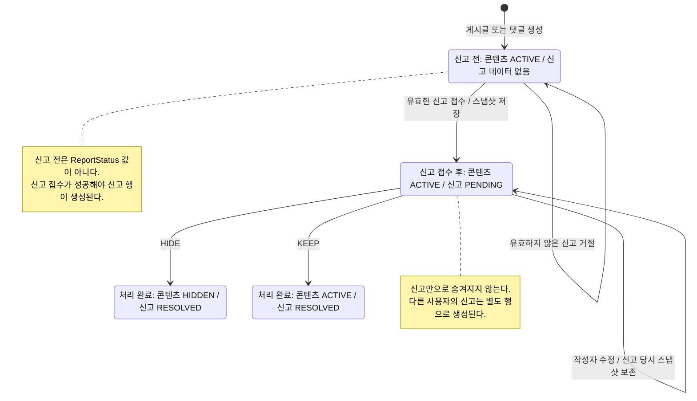
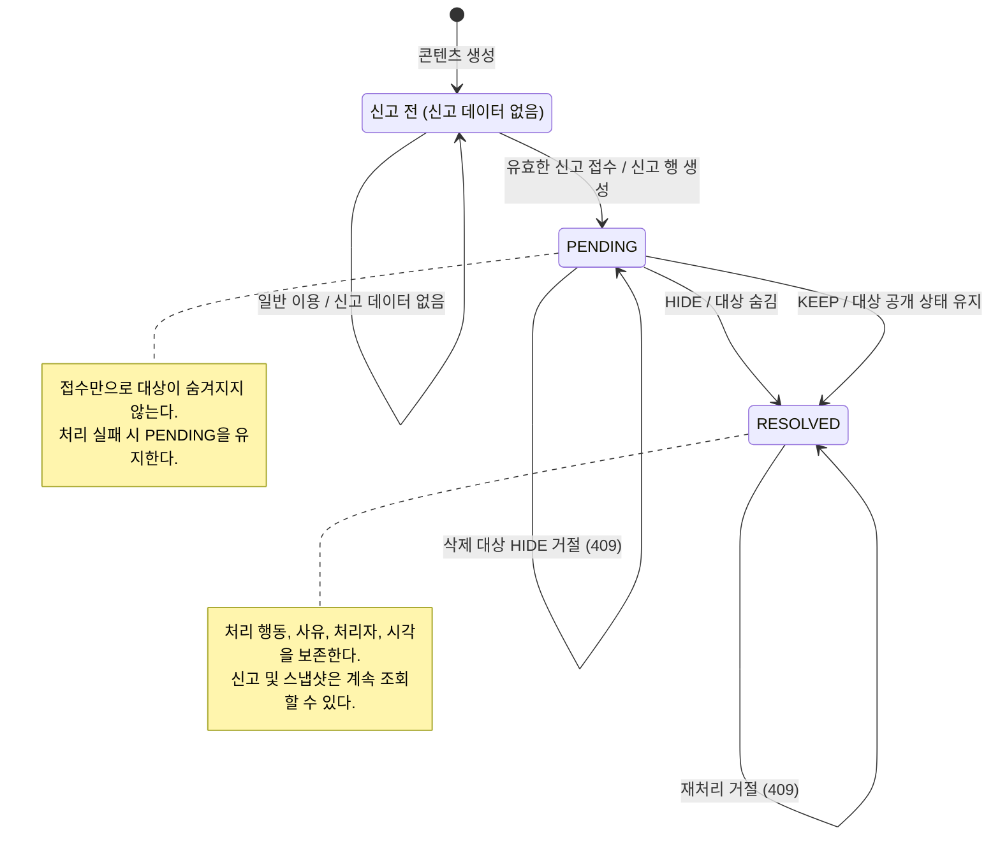
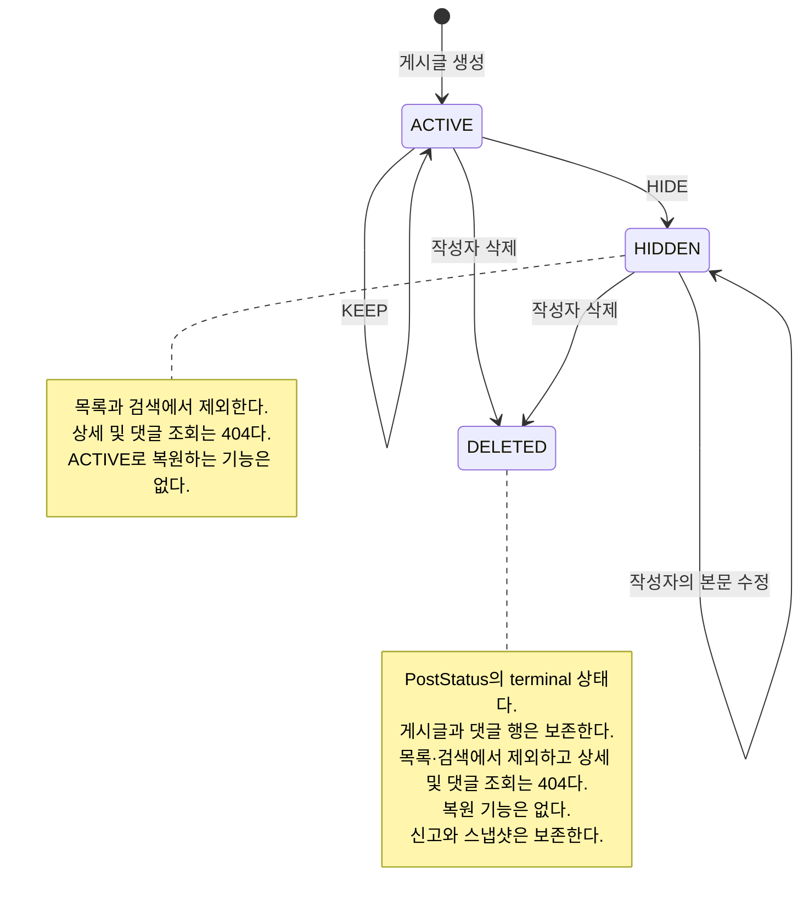
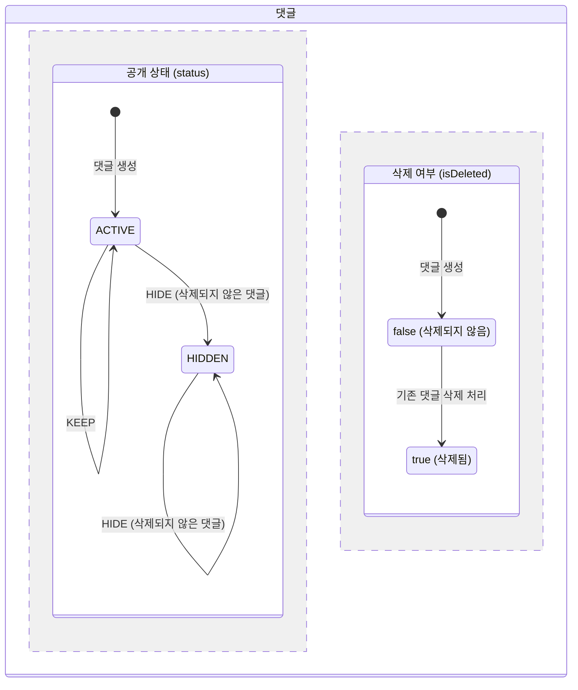

# 4주차 신고·댓글 조회 API

게시글·댓글 신고, 신고 목록·검색, 신고 처리와 댓글 목록·검색을 제공한다. 로그인과 ADMIN 역할은 추가하지 않는다. 요청의 사용자 ID가 존재하는지 확인하는 과제용 방식이며, 존재하는 사용자라면 누구나 신고를 처리하고 조회할 수 있다.

게시글 작성자 삭제는 `DELETED` 상태로 전환하는 soft-delete로 처리한다. 게시글과 댓글 행 및 신고 스냅샷은 보존한다.

## API

| 요청 | 입력 | 결과 |
| --- | --- | --- |
| POST /api/v1/posts/{postId}/reports | reporterId, reason | 게시글 신고 생성, 201 |
| POST /api/v1/comments/{commentId}/reports | reporterId, reason | 댓글 신고 생성, 201 |
| GET /api/v1/posts/{postId}/comments | page, size, keyword | 해당 게시글의 댓글 목록·본문 검색 |
| GET /api/v1/reports | page, size, status, targetType, targetId, keyword | 신고 목록·스냅샷 검색 |
| PATCH /api/v1/reports/{reportId}/resolve | processorId, action, resolutionReason | 신고 처리, 200 |

reason과 resolutionReason은 공백 불가·최대 255자다. 사용자·대상 ID는 양수여야 한다. 모든 응답은 success, 문자열 code, message, data를 사용한다. 성공 코드는 S200/S201이며 실패 시 data는 null이다.

게시글·댓글·신고 목록의 data는 items, page, size, totalElements, totalPages로 통일한다. page는 1부터, size는 기본 10·최대 100이다. 생성 시각과 ID 내림차순으로 정렬한다. 기존 게시글 목록의 data 배열은 이 페이징 객체로 변경되었다.

댓글은 parentId로 대댓글을 연결한 평평한 목록이다. 부모가 다른 페이지에 있어도 ID를 유지한다. 숨김·삭제 댓글은 일반 목록에 안내 문구와 상태만 표시하고 본문 검색에서는 제외한다. 삭제 표시가 우선한다. keyword가 없거나 공백이면 전체 목록이다. 검색은 대소문자를 구분하지 않는 부분 일치이며 %, _, !도 입력 문자 그대로 찾는다.

신고의 status, targetType, targetId 필터는 AND 조건이다. targetId만 지정하면 대상 종류와 무관하게 해당 ID의 신고를 조회한다. keyword는 신고 사유·제목 스냅샷·본문 스냅샷 중 하나라도 포함하면 일치한다. 현재 원문은 검색하지 않는다. 처리 후에는 신고 목록에서 action, resolutionReason, processorId, resolvedAt도 확인할 수 있다.

## 상태와 처리 행동

HIDE/KEEP는 상태가 아닌 신고 처리 행동이다. 신고 상태와 대상의 공개 상태는 각각 관리하며, 신고 처리와 대상 숨김은 하나의 트랜잭션으로 반영한다.

### 콘텐츠 생성부터 신고 처리까지

게시글·댓글을 생성하면 공개 상태는 ACTIVE다. 댓글의 isDeleted는 false다. 신고가 접수되기 전에는 해당 신고 데이터가 없으며, 일반 조회·검색과 작성자의 수정이 가능하다. 댓글의 수정은 기존 도메인 동작이며 이번에 수정 API를 추가한 것은 아니다.

아래는 공개 중인 콘텐츠에 신고 한 건이 접수되어 처리되는 전체 흐름이다. 각 상자는 콘텐츠와 신고의 상태를 함께 설명하며, 별도의 enum 값을 추가한 것이 아니다.



위 흐름은 대상이 삭제되거나 다른 신고로 먼저 숨겨지지 않은 경우다. 검토 중 대상이 삭제되면 KEEP만 가능하다. 다른 신고로 이미 숨겨졌다면 KEEP로 처리해도 HIDDEN을 유지한다. 상세 규칙은 아래 상태도와 같다.

### 신고 상태

실제 ReportStatus 값은 PENDING과 RESOLVED뿐이다. 신고 전 단계는 신고 행이 아직 없는 상황을 표시한다.



신고는 PENDING에서 RESOLVED로 한 번만 전이한다. 같은 대상의 다른 신고도 자동 처리하지 않는다. 거절 요청의 자기 전이는 오류 후 상태가 유지된다는 뜻이며, 새로운 처리 이력을 저장한다는 뜻이 아니다.

### 게시글 공개 상태

다음 HIDE/KEEP 전이는 해당 게시글의 PENDING 신고를 처리하는 경우를 나타낸다. HIDDEN 상태에서의 처리는 숨김 전에 접수된 다른 신고가 있을 때 가능하다.



KEEP는 ACTIVE를 강제하지 않으며 다른 신고로 숨겨진 대상을 복원하지 않는다.

### 댓글 공개 상태와 삭제 여부

댓글의 공개 상태(status)와 삭제 여부(isDeleted)는 별개다. 아래 상태도는 두 값을 나란히 표시한다. 댓글의 HIDE는 삭제되지 않은 댓글에만 가능하며 부모 게시글을 숨기지 않는다.



isDeleted가 true이면 공개 상태와 관계없이 삭제 표시가 우선한다. 삭제된 댓글의 신고도 KEEP로 종결할 수 있지만 HIDE는 409다. 부모 게시글이 DELETED여도 댓글 행은 보존되지만 댓글 조회·검색·신고는 차단된다. 부모의 DELETED 상태와 댓글 자체의 공개 상태·삭제 여부는 구분한다.

| 댓글 공개 상태 | 삭제 여부 | 일반 목록 | 본문 검색 |
| --- | --- | --- | --- |
| ACTIVE | false | 원문 표시 | 포함 |
| HIDDEN | false | 숨김 안내 문구 | 제외 |
| ACTIVE 또는 HIDDEN | true | 삭제 안내 문구 | 제외 |

부모 게시글이 HIDDEN이면 댓글 목록·검색 전체를 404로 차단한다.

신고 접수는 대상 공개 상태를 바꾸지 않는다. 신고 당시 스냅샷은 대상이 수정·삭제되어도 보존한다. HIDE는 수정된 현재 대상을 숨긴다. 게시글이 DELETED이거나 댓글이 논리 삭제되었으면 KEEP로 종결할 수 있지만 HIDE는 409다. 삭제 대상 처리 응답은 targetAvailable=false, targetHidden=null이다.

숨김 게시글은 목록·제목 검색에서 제외하고 상세·댓글 조회는 404로 응답한다. 숨김 후 작성자가 수정해도 HIDDEN을 유지한다. 작성자가 숨김 게시글을 삭제하면 DELETED로 전환한다. DELETED 게시글은 DB 행을 보존하지만 목록·검색·상세·댓글·신고 대상 조회에서 제외하고 검색 프로젝션에서 제거한다. 연관 댓글도 DB에 보존하되 공개 조회와 신고 접수를 차단한다. 게시글 수정·재삭제는 404이며 복원 기능은 없다. 과거 검색 이력·검색어 사전·집계 검색량은 유지하므로 숨김·삭제 게시글과 같은 문자열이 검색어 추천에 남을 수 있다.

## 중복과 동시성

동일 사용자는 같은 대상 종류·ID를 한 번만 신고할 수 있다. 처리 후에도 재신고할 수 없다. 서비스 검사에 더해 DB의 uk_report_reporter_target 유니크 제약으로 보장한다. 해당 제약 위반만 중복 신고 409로 변환하며, 다른 DB 오류를 중복으로 처리하지 않는다.

신고 처리는 신고 행 → 게시글 행 → 댓글 행 순서로 잠근다. 댓글 대상에서만 댓글 행을 잠근다. 게시글 수정·삭제와 신고 접수도 같은 게시글 우선 잠금 순서를 사용한다. 처리 상태·이력과 콘텐츠 숨김은 같은 트랜잭션으로 반영한다. 이미 처리된 신고는 409이며 최초 결과를 덮어쓰지 않는다.

## 오류

| 조건 | HTTP / code |
| --- | --- |
| 잘못된 입력·페이징 | 400 / COMMON400_VALIDATION 또는 COMMON400_TYPE |
| 본인 콘텐츠 신고 | 403 / REPORT4031 |
| 없는 사용자·게시글·댓글·신고 | 404 / USER4001, POST4001, COMMENT4001, REPORT4001 |
| 숨김 콘텐츠 신규 신고 | 404 / POST4001 또는 COMMENT4001 |
| 중복 신고 | 409 / REPORT4091 |
| 삭제 댓글 신고 | 409 / REPORT4092 |
| 이미 처리된 신고 | 409 / REPORT4093 |
| 삭제 대상 HIDE | 409 / REPORT4094 |

## 기존 영구 H2 데이터

Hibernate 초기화 전에 기존 테이블을 점검한다. 기존 게시글·댓글은 ACTIVE, 신고는 PENDING으로 누락 상태만 보정한다. 기존 상태와 스냅샷은 유지한다. 빈 DB는 Hibernate가 새 테이블을 만든다. 이 보정은 현재 프로젝트의 H2 설정을 대상으로 한다.

기존 중복 신고가 있으면 어떤 행도 자동 삭제하지 않고 중복 키와 건수를 알리며 시작을 중단한다. 제약을 적용할 수 없는 상태로 서버가 실행되지 않게 한다. 다음 조회로 원본을 확인하고, 보존할 이력에 대한 결정을 내린 뒤 중복을 정리하고 재시작한다.

```sql
SELECT reporter_id, target_type, target_id, COUNT(*) AS duplicate_count
FROM reports
GROUP BY reporter_id, target_type, target_id
HAVING COUNT(*) > 1;
```

## Datafaker 목 데이터

신고·댓글 조회를 더 많은 데이터로 실습하려면 프로젝트 디렉터리에서 다음 명령을 실행한다.

```sh
./gradlew seedMockData --args='--spring.jpa.show-sql=false'
```

HTTP 서버를 시작하지 않고 사용자·게시글·댓글을 저장한 뒤 종료한다. 기본 대상은 기존 로컬 H2 DB인 data/blog이며, BLOG_DB_URL을 설정하면 해당 DB를 사용한다. 별도 실습 DB에 넣으려면 다음처럼 실행한다.

```sh
./gradlew seedMockData --args='--spring.datasource.url=jdbc:h2:file:./data/mock-blog --spring.jpa.show-sql=false'
```

| 데이터 | 생성 개수 | 구성 |
| --- | --- | --- |
| 사용자 | 5명 | Datafaker 한국어 이름, mock-user-1부터 mock-user-5까지 전용 이메일 |
| 게시글 | 12개 | ACTIVE 10개, HIDDEN 2개, 제목에 [MOCK] 표시 |
| 댓글 | 36개 | 대댓글 12개 포함, HIDDEN 2개, 삭제 댓글 2개 |

Datafaker 2.7.0으로 이름·제목·본문을 생성한다. locale은 ko, 난수 seed는 20261026으로 고정한다. locale에 없는 텍스트 제공자는 기본 언어로 대체될 수 있어 본문 전체가 한국어인 것은 아니다. locale 및 seed 설정은 [Datafaker 공식 사용법](https://www.datafaker.net/documentation/usage/)을 따른다.

이름은 최대 50자, [MOCK] 접두어를 포함한 제목은 최대 150자로 제한한다. 댓글에는 질문·답변·의견 표식을 유지한다. 작성자·게시글·부모 댓글 연결과 숨김·삭제 상태는 생성기가 정하고, Datafaker는 텍스트만 만든다. 신고 데이터는 자동 생성하지 않는다.

같은 라이브러리 버전과 생성 순서에서는 같은 텍스트를 생성한다. DB ID와 생성 시각은 고정하지 않는다. 기존 데이터를 삭제하거나 덮어쓰지 않고 추가하며, 전용 이메일 mock-user-1@blog.example이 이미 있으면 생성을 건너뛴다. 이전 고정 문자열 목 데이터가 있어도 그대로 보존한다. 이 이메일을 기존 목 데이터의 표식으로 사용하므로 일부 데이터가 수동 삭제되었더라도 자동 복구하지 않는다.

생성은 mock-data 프로필에서만 수행한다. 일반 서버 시작에는 자동 삽입하지 않는다. 명령이 끝난 뒤 평소대로 서버를 실행하면 저장된 데이터를 조회할 수 있다. 시작 로그의 “목 사용자”와 “목 게시글” 행에서 실제 사용자·게시글·댓글 ID를 확인한다.

조회 예시:

- 게시글 목록: GET /api/v1/posts?keyword=MOCK&page=1&size=3 — 숨김 게시글을 제외한 10개를 페이징한다.
- 댓글 목록: GET /api/v1/posts/{postId}/comments — 대댓글 관계와 숨김·삭제 안내 문구를 확인한다.
- 댓글 검색: GET /api/v1/posts/{postId}/comments?keyword=질문 — 숨김·삭제 댓글을 제외한다.

## Swagger 시연

시연 데이터는 moderation-demo 프로필에서만 넣는다. 기존 로컬 DB와 분리하려면 프로젝트 디렉터리에서 다음 명령으로 실행한다.

```sh
./gradlew bootRun --args='--spring.profiles.active=moderation-demo --spring.datasource.url=jdbc:h2:file:./data/moderation-demo'
```

Swagger 경로는 /swagger-ui.html이다. 최초 시작 로그의 “신고 데모” 행에 authorId, reporterId, processorId, postId, commentId가 표시된다. 사용자 3명과 게시글 1개, 부모 댓글·대댓글·삭제 댓글을 만든다. 재시작 시 데이터를 중복 생성하거나 기존 처리 결과를 초기화하지 않는다.

1. 댓글 목록·본문 검색에서 원문, parentId, 삭제 안내 문구를 확인한다.
2. reporterId로 게시글과 부모 댓글을 각각 신고한다. 응답의 reportId를 기록한다. 같은 요청을 반복하면 409다.
3. 신고 목록에서 status=PENDING, targetType=COMMENT 또는 keyword로 신고와 스냅샷을 찾는다.
4. 댓글 신고를 processorId와 action=HIDE로 처리한다. 게시글은 계속 조회되고 댓글은 안내 문구로 바뀌며 검색에서 제외된다.
5. 게시글 신고를 HIDE로 처리한다. 게시글 목록·검색에서 제외되고 상세·댓글 조회는 404다.
6. 같은 신고를 재처리하면 409다. KEEP를 확인하려면 숨김 전에 다른 사용자로 같은 대상에 신고를 하나 더 접수한 뒤 해당 신고를 KEEP로 처리한다. 숨김은 해제되지 않는다.

## 검증

HTTP 통합 테스트에서 API 5개, 페이징·검색, 입력 검증, 본인 신고 금지, 동시 신고·동시 처리, KEEP의 상태 유지, 수정·삭제 경합, 삭제 대상 처리와 롤백을 검증한다. 별도 DB 테스트는 기존 상태 보정·중복 탐지·유니크 제약을 검증한다. moderation-demo 테스트는 시연 데이터와 OpenAPI 경로를 확인한다.

```sh
./gradlew test
```
