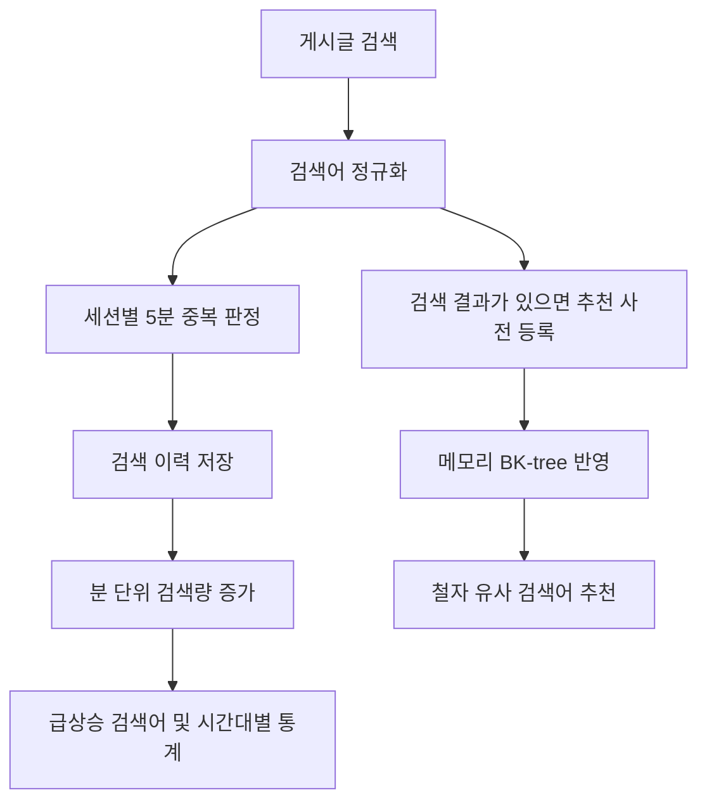

# 4주차: 유사 검색어 추천과 급상승 검색어

## 실행

Java 21과 Gradle wrapper를 사용한다. kanghyeonwoo 디렉터리에서 실행한다.

```bash
./gradlew bootRun --args='--spring.profiles.active=demo'
```

데모 프로필은 작성자 1명, 게시글 2개, 검색어 8개, 집계 이력 43개, 중복 판정 상태 43개, 분 단위 집계 8개를 삽입한다. 기본 실행은 추천 사전의 초기 단어만 넣고 데모 이력은 넣지 않는다.

기본 DB는 실행 디렉터리의 data/blog 파일 기반 H2이며 BLOG_DB_URL로 접속 주소를 변경할 수 있다. DB 파일은 Git에서 제외한다. 테스트는 별도 인메모리 H2와 임시 파일 DB를 사용한다.

데모는 검색 데모 작성자의 고유 이메일을 완료 표식으로 사용해 한 트랜잭션에서 한 번만 삽입한다. 재시작해도 이력을 중복 삽입하거나 시각을 갱신하지 않는다. 검색 시각은 최초 삽입 시점으로 옮겨지며 시간이 지나면 급상승 순위에서 자연스럽게 빠진다. 새 데모가 필요하면 기존 DB를 삭제하는 대신 별도의 파일 DB URL로 실행할 수 있다.

## API 시연

```bash
curl -G 'http://localhost:8080/search/suggestions' --data-urlencode 'keyword=sprng'
curl -G 'http://localhost:8080/search/suggestions' --data-urlencode 'keyword=스프링부투'
curl 'http://localhost:8080/search/trends'
```

- sprng 추천: spring(거리 1)
- 스프링부투 추천: 스프링부트(거리 1), 스프링(거리 2)
- 데모 최초 삽입 직후 급상승: spring(점수 1.6), jpa(1.2), java(0.8)

트렌드나 추천 응답의 keywordId를 아래 ID 자리에 넣는다. ID는 기존 DB 상태에 따라 달라지므로 고정값으로 가정하지 않는다.

```bash
curl 'http://localhost:8080/search/keywords/ID/stats'
```

최근·직전 60분 검색량, 상승 점수, 현재 시간대를 포함한 최근 24개 시간대의 검색량을 반환한다. 현재 시간대는 partial=true이고 나머지 빈 구간은 0이다. 시간대는 Asia/Seoul, 저장 시각은 UTC다.

실제 검색을 같은 쿠키로 반복하면 같은 검색어는 5분 내 한 번만 집계한다.

```bash
curl -c /tmp/blog-search-cookies -b /tmp/blog-search-cookies -G 'http://localhost:8080/posts' --data-urlencode 'keyword=spring'
```

검색어는 NFC·영문 소문자·공백 통합 후 2~50자로 제한한다. 첫 페이지 검색만 집계한다. 결과가 없어도 검색 이력을 남기지만 추천 사전에는 등록하지 않는다. 목록·추천·트렌드·통계 조회와 두 번째 이후 페이지 조회는 집계하지 않는다.

모든 응답은 기존 ApiResponse 형식이다. 유효하지 않은 검색어와 페이지 값은 400, 없는 통계 검색어 ID는 404다. Swagger UI는 /swagger-ui.html에서 확인한다.

## 데이터 흐름



검색어는 search_keywords, 이력은 search_events, 중복 판정은 search_dedup_states, 분 단위 집계는 search_keyword_buckets에 저장한다. 집계 대상 검색의 이력·중복 상태·분 단위 검색량은 같은 트랜잭션으로 변경한다. 순위 자체를 저장하는 테이블은 없다.

BK-tree는 서버 시작 시 사전으로 구성하고, 이후 새 사전 단어는 다음 추천 요청에서 추가한다. DB 커밋 후에만 사전 변경을 반영한다. 추천은 편집 거리, 최근 1시간 검색량, 검색어 사전순으로 최대 5개다. 2~4자 입력은 거리 1, 5자 이상 입력은 거리 2까지 탐색한다. 같은 단어는 제외한다. 의미 기반 추천이나 접두어 자동완성과는 별도 기능이다.

급상승 후보는 최근 60분에 5회 이상 검색됐고 직전 60분보다 검색량이 증가한 단어다. 점수는 `(최근 검색량 - 직전 검색량) / max(직전 검색량, 5)`이다. 완전한 분은 버킷을 집계하고 부분 분은 원본 이력으로 보정해 60분 경계를 정확하게 유지한다.

검색 테이블은 SQL 스키마와 JdbcTemplate으로, 기존 게시글은 JPA로 관리한다. 단일 서버의 쓰기는 커밋까지 직렬화하며 DB 유니크 제약과 행 잠금을 적용한다. 시작 시 누락된 제목 정규화와 버킷 복구를 수행하고, 30일이 지난 검색 이력과 집계 상태는 시작 시 및 주기적으로 정리한다.

## 계층별 구조와 세션 처리

- controller: 요청 입력, 서비스 호출, 응답 포장.
- service: 게시글 검색과 검색량 기록의 흐름, 추천·급상승·통계 계산.
- repository: 검색용 SQL과 검색 이력·분 단위 집계·중복 상태의 트랜잭션 처리.
- dto: 추천·급상승·시간대별 통계 응답.
- config: 초기화·데모 데이터 구성과 웹 요청의 세션 식별자 해석.
- util: HTTP·DB에 의존하지 않는 BK-tree와 검색어 정규화.

PostSearchService가 PostService의 조회가 끝난 뒤 집계 대상인지 판단한다. 세션 키는 SearchSession을 통해 필요할 때 조회하며, 실제 HttpSession 접근은 SearchSessionArgumentResolver가 담당한다. 목록 조회·후속 페이지·잘못된 검색 요청에서는 세션을 생성하지 않는다. PostSearchService는 게시글 조회와 집계 전체를 하나의 트랜잭션으로 감싸지 않는다. 따라서 집계 잠금을 기다리는 동안 게시글 조회 연결을 계속 보유하지 않는다.

검색 전용 최상위 패키지는 역할별 패키지로 정리했고, SQL은 SearchRepository로 모았다. 데모 데이터의 삽입 트랜잭션도 저장소에서 관리한다.

## 검증 방법

```bash
./gradlew test
```

고정 Clock과 실제 H2를 사용해 API 응답, 추천 거리, 동시 검색 중복 제외, 5분·60분 경계, 시간대별 통계, 데모 삽입과 파일 DB 재시작을 검증한다. 데모와 테스트는 동일한 예시 리소스를 사용한다.
